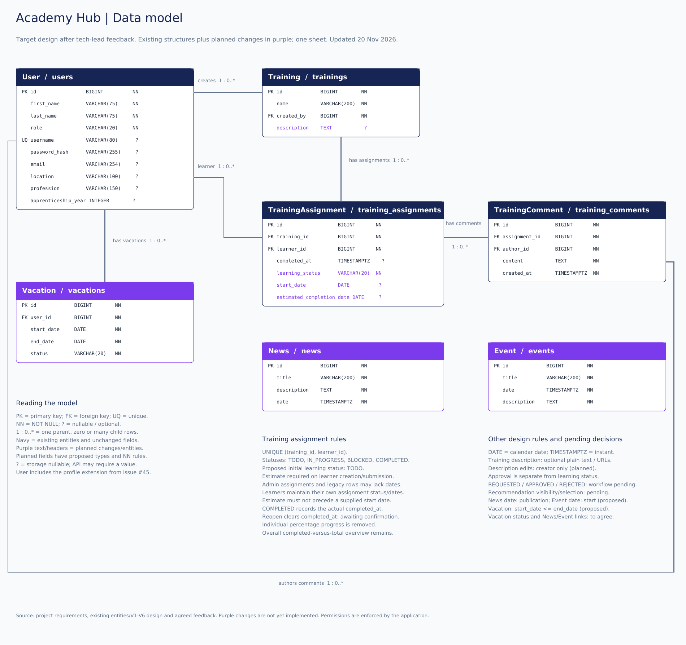

# Academy Hub

A central web application for Academy learners and admins to manage training activities and access Academy information. The longer-term product includes a Dashboard, Training Tracker, Vacation Planner, and Learner Hub.

## Table of Contents

- [Project Overview](#project-overview)
- [Technology Stack](#technology-stack)
- [Repository Structure](#repository-structure)
- [Local Setup](#local-setup)
  - [Prerequisites](#prerequisites)
  - [Clone the Repository](#clone-the-repository)
  - [Environment Configuration](#environment-configuration)
  - [Start the Database](#start-the-database)
  - [Start the Backend](#start-the-backend)
  - [Start the Frontend](#start-the-frontend)
  - [Verify the Setup](#verify-the-setup)
  - [Local Demo Accounts](#local-demo-accounts)
- [API Documentation](#api-documentation)
- [Running Tests](#running-tests)
- [Data Model](#data-model)
- [Development Workflow](#development-workflow)
- [Project Resources](#project-resources)
- [Troubleshooting](#troubleshooting)

## Project Overview

Learners retrieve assigned trainings, update individual percentage progress, complete assignments, and exchange comments with admins. Admins create and rename trainings, manage assignments, delete trainings, and retrieve individual learners' assignments. Authentication uses server-side sessions and role-based access.

This describes the supplied backend. Descriptions, learner-training approval, and replacing percentages with statuses and estimates are separate planned changes. Current HTTP training-management routes are admin-only. Mockups can represent features that are not yet implemented.

## Technology Stack

| Area | Technology |
| --- | --- |
| Language | Java 21, configured in `pom.xml` |
| Backend | Spring Boot 4.1.1, Spring Web MVC |
| Persistence | Spring Data JPA / Hibernate |
| Database | PostgreSQL 17; Podman Compose for local development |
| Migrations | Flyway |
| Security | Spring Security, sessions, BCrypt, CSRF protection |
| Build | Maven Wrapper |
| API documentation | Springdoc OpenAPI 3.2.0 / Swagger UI |
| Backend tests | JUnit, Mockito, Spring Boot Test, MockMvc |
| Frontend | Not included in the supplied repository snapshot |

## Repository Structure

```text
Academy-Hub/
├── README.md
├── compose.yaml
├── .env.example
├── docs/
│   ├── api.md
│   ├── data-model/
│   │   ├── academy-hub-data-model.drawio
│   │   └── academy-hub-data-model.png
│   └── TASK-*.md
└── academy-hub-backend/
    ├── pom.xml
    ├── mvnw
    ├── mvnw.cmd
    └── src/
        ├── main/
        │   ├── java/ch/accenture/academyhub/
        │   └── resources/
        │       ├── application.yaml
        │       └── db/migration/
        └── test/java/ch/accenture/academyhub/
```

## Local Setup

### Prerequisites

- Repository access and Git.
- JDK 21; check `java -version`.
- Podman and a working Compose provider; check `podman --version` and `podman compose version`.
- Internet access for Maven dependency downloads.
- An IDE such as IntelliJ IDEA, or a terminal.

Maven is supplied through the committed wrapper; no separate installation is needed.

On Windows/macOS, start the Podman machine through Podman Desktop. Alternatively, check `podman machine list` and start a stopped machine with `podman machine start`. Only if none exists, run `podman machine init` first. Native Linux normally needs no Podman machine.

### Clone the Repository

```bash
git clone https://github.com/tseLha00/Academy-Hub.git
cd Academy-Hub
```

### Environment Configuration

From the repository root, copy `.env.example` to `.env`.

macOS / Linux:

```bash
cp .env.example .env
```

Windows PowerShell:

```powershell
Copy-Item .env.example .env
```

Edit the local values:

```dotenv
POSTGRES_DB=academy_hub
POSTGRES_USER=academy_hub
POSTGRES_PASSWORD=replace-with-your-local-password

DB_URL=jdbc:postgresql://localhost:5432/academy_hub
DB_USERNAME=academy_hub
DB_PASSWORD=replace-with-your-local-password

API_DOCS_ENABLED=true
```

Keep both database passwords consistent. Database name and username must also match. `.env` is ignored by Git; do not commit database credentials or real account passwords. The explicitly documented local demo credentials below are only for development.

The backend imports `../.env` relative to its working directory. Start it from `academy-hub-backend/`, or use that directory as the IDE run configuration's working directory.

### Start the Database

From the repository root:

```bash
podman compose up -d postgres
podman ps
podman exec academy-hub-postgres pg_isready -h localhost -p 5432
```

Wait for `accepting connections`. Check failures with:

```bash
podman logs academy-hub-postgres
```

PostgreSQL is exposed on `localhost:5432`. Its named volume preserves data between restarts. Changing `.env` does not change credentials in an already-initialised database.

### Start the Backend

From the repository root:

```bash
cd academy-hub-backend
```

macOS / Linux:

```bash
./mvnw spring-boot:run
```

If permission is denied, run `chmod +x mvnw` once and retry.

Windows PowerShell:

```powershell
.\mvnw.cmd spring-boot:run
```

The backend listens at `http://localhost:8080`. Flyway applies pending migrations and Hibernate validates the schema. Wait for the application's `Started ...` log message.

In IntelliJ, import the backend `pom.xml` as a Maven project, select Java 21 for the project SDK and Maven runner, and run `AcademyHubBackendApplication` with the backend directory as its working directory.

Stop the application with `Ctrl+C`. From the root, `podman compose stop postgres` stops the database while retaining data; `podman compose up -d postgres` starts it again.

### Start the Frontend

The supplied repository contains no frontend directory, `package.json`, or lockfile. Its dependency installation, startup, test, and build commands cannot yet be specified accurately.

When frontend source is available, document its folder, supported Node version, package manager, scripts, environment variables, local URL, and proxy/CORS settings here. Browser integration must support backend session cookies and CSRF protection.

### Verify the Setup

1. Confirm PostgreSQL accepts connections.
2. Confirm the backend starts without migration/schema errors.
3. Open [Swagger UI](http://localhost:8080/swagger-ui.html).
4. Execute `GET /api/auth/csrf`; expect a token and header name.
5. Follow the [Swagger login walkthrough](docs/api.md#sign-in-through-swagger-ui).
6. Check `GET /api/auth/me` returns your signed-in account.

Use the [local demo accounts](#local-demo-accounts) below if they exist in your local database.

### Local Demo Accounts

These accounts are available in the existing demo database. They are for local development and manual API testing only.

| Username | Password | Role |
| --- | --- | --- |
| `test.learner` | `AcademyDemo2026!` | LEARNER |
| `test.learner2` | `AcademyDemo2026!` | LEARNER |
| `demo.admin` | `AcademyDemo2026!` | ADMIN |


The supplied Flyway migrations do not seed these users. A fresh database may therefore have none of these accounts. Starting the backend against an existing database preserves its users; it does not prove they were created automatically. If the accounts are missing, follow [local account provisioning](docs/TASK-08-authentication.md#existing-user-records) or ask the backend owner to provision them. There is no demo seed command included yet.

To check available accounts, run this in DBeaver connected to your local Academy Hub database:

```sql
SELECT id, username, first_name, last_name, role
FROM users
ORDER BY id;
```

Use the credentials through the [Swagger login flow](docs/api.md#sign-in-through-swagger-ui). Do not use these demo passwords for real accounts or deployed environments.

## API Documentation

- [Swagger UI](http://localhost:8080/swagger-ui.html): endpoints, schemas, and interactive requests.
- [OpenAPI JSON](http://localhost:8080/v3/api-docs).
- [OpenAPI YAML](http://localhost:8080/v3/api-docs.yaml).
- [API walkthrough](docs/api.md): login, CSRF, roles, and ID usage.

Each teammate uses their own locally running Swagger UI; no shared Postman workspace is required. Localhost links work only while the backend is running.

Documentation can be read without login; business endpoints retain their security. Set `API_DOCS_ENABLED=false` and restart to disable documentation.

## Running Tests

Start PostgreSQL first. The backend need not run separately: Spring tests start the contexts they need.

From `academy-hub-backend/`, macOS / Linux:

```bash
./mvnw test
```

Windows PowerShell:

```powershell
.\mvnw.cmd test
```

For documentation/security tests only:

```bash
./mvnw test -Dtest=OpenApiDocumentationTest
```

Integration tests use the configured datasource. Use a local development database. Reports are in `academy-hub-backend/target/surefire-reports/`; successful runs end in `BUILD SUCCESS` without failures/errors.

Frontend test commands will be added once the actual frontend scripts and test runner are supplied.

## Data Model



[Editable draw.io model](docs/data-model/academy-hub-data-model.drawio).

The diagram is the target design: navy shows existing entities and unchanged fields; purple shows planned entities or field changes. It includes the user-profile extension and the agreed upcoming training description, learning-status, and date changes. The committed Flyway migrations define the actual schema of your checkout; a planned field in the diagram does not mean its API or database change is already implemented.

Training stores shared information. TrainingAssignment connects a learner to a training and holds their individual learning information. TrainingComment belongs to one assignment and references its author. Vacation, News, and Event are proposed models.

To edit the diagram, open `docs/data-model/academy-hub-data-model.drawio` in draw.io, save to the same file, and export a PNG to `docs/data-model/academy-hub-data-model.png`. Commit both files with the related task. Editing the diagram does not change Java entities or the database.

## Development Workflow

Begin a new task with a clean working tree and updated `main`:

```bash
git status
git switch main
git pull --ff-only origin main
git switch -c feature/ISSUE_NUMBER-short-description
```

Replace the branch suffix with the actual issue number and a short task name. Work on one branch per ticket and open a pull request to `main`. If local changes exist, commit or deliberately set them aside before switching.

Before review:

- Run relevant tests and `git diff --check`.
- Explain the changed behaviour and validation in the PR.
- Link the issue; use `Closes #NUMBER` when the PR completes it.
- Update API descriptions and the data model when affected.
- Coordinate new Flyway version numbers with teammates.

Use the IDE formatter and existing project conventions. Do not commit credentials or generated build output. Add new migrations rather than changing already-applied migrations.

## Project Resources

- [Issues](https://github.com/tseLha00/Academy-Hub/issues)
- [Repository projects](https://github.com/tseLha00/Academy-Hub/projects): navigate to the team's board.
- [API walkthrough](docs/api.md)
- [Authentication notes](docs/TASK-08-authentication.md)
- [Authenticated access notes](docs/TASK-09-authenticated-training-access.md)
- [Completion notes](docs/TASK-10-training-completion.md)
- [Progress notes](docs/TASK-11-training-progress.md)

Add the approved mockup URL and direct project-board URL when supplied. Historical task notes describe their implementation stage; current code and generated API documentation take precedence if details differ.

## Troubleshooting

| Problem | Check / solution |
| --- | --- |
| Podman cannot connect | On Windows/macOS, check Podman Desktop or `podman machine list`; start the existing machine. |
| Compose provider missing | Check `podman compose version`; install/configure the team's provider. |
| OCI/cgroup container error | Restart the Podman machine and retry. If persistent, share error and Podman version before resetting anything. |
| Port 5432 occupied | Check other PostgreSQL instances/containers. If changing Compose's host port, update `DB_URL` too. |
| Database connection refused | Check running container, readiness, and logs. |
| Database password rejected | Match the database's initialised credentials; editing `.env` does not reset its password. |
| `DB_URL` unresolved | Check root `.env` and backend working directory. |
| Maven dependency download fails | Check network/VPN/proxy access to Maven Central and company Maven settings. |
| Java release error | Align terminal Java, IDE SDK, and Maven runner with Java 21. |
| Wrapper permission denied | On macOS/Linux, `chmod +x mvnw` or `bash mvnw ...`; on Windows use `mvnw.cmd`. |
| Flyway checksum mismatch | Review branch/migration history with the team; do not edit applied migrations to bypass it. |
| Swagger 404 | Check updated backend is running and `API_DOCS_ENABLED` is not false. |
| Swagger 401 | Check documentation paths are permitted in updated `SecurityConfig` and restart. |
| Business API 401 | Sign in and retain the session cookie using the same hostname. |
| Business API 403 | Check role/ownership and authorise a fresh response-body CSRF token. |
| Frontend cannot reach API | Check actual API URL, proxy/CORS, cookies, and CSRF once frontend configuration is available. |

Do not delete the PostgreSQL volume as a routine troubleshooting step: it contains the local database.
